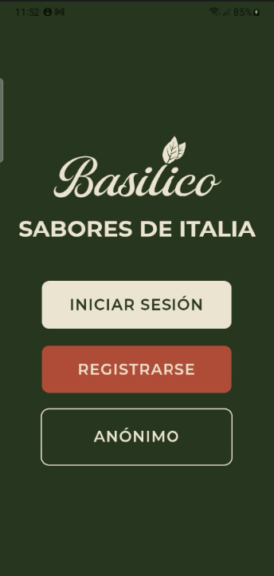
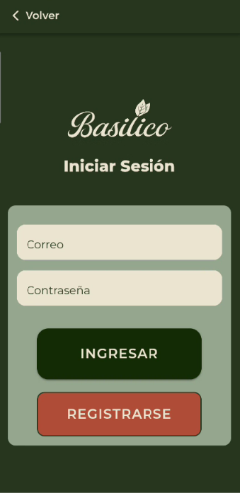
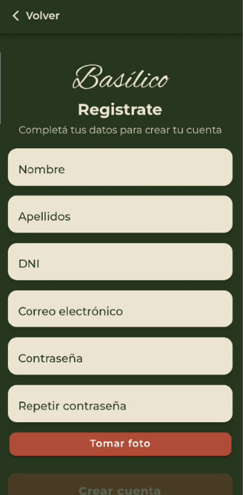
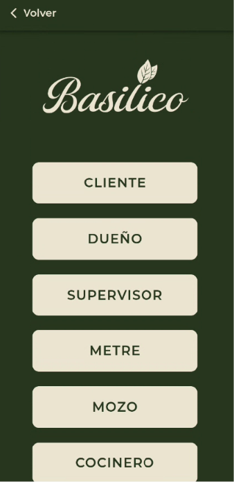

# Basilico - Proyecto de Gestión de Restaurante 🍽️
### **Grupo:** Basilico - 2026

### **Tecnicatura Universitaria en Programación - UTN Avellaneda**

 `Link del proyecto Supabase:` https://xmlcpvfjlnuakqehrvom.supabase.co --> integrado al repo
---

## 👥 Integrantes y Responsabilidades

De acuerdo con las pautas del Trabajo Final Integrador, a continuación se detallan los módulos asignados, las fechas estimadas de desarrollo y las ramas de trabajo de cada integrante:

### Francisco Cuenca Backoffice (Dueño / Supervisor)
Puntos del enunciado: 1, 4, 6, 7, 8, 22, 25
Punto 1 — Alta de empleado (foto desde cámara, lectura QR de DNI, validaciones)
Punto 4 — Alta y gestión de mesas (tipo, disponibilidad, foto) + generación automática de QR de mesa
Punto 6 — Listado de clientes pendientes de aprobación (con push notification)
Punto 7 y 8 — Aceptar/rechazar cliente + envío de correo automático personalizado (logo, fuentes,
colores propios)
Punto 22 — Generación de factura en PDF + notificación automática a dueño/supervisor tras el pago
Punto 25 — Aprobación/rechazo de reservas (segunda/tercera fecha)

### Keila Aristimuño— Cocina y Bar (Productos)
Puntos del enunciado: 2, 3, 16, 17, 18
Punto 2 — Alta de plato (nombre, descripción, tiempo, precio, 3 fotos con carrusel)
Punto 3 — Alta de bebida (misma lógica que plato)
Punto 16 — Pantalla de pedidos pendientes en cocina, agrupados por mesa
Punto 17 — Pantalla de pedidos pendientes en bar, agrupados por mesa
Punto 18 — Marcar productos listos y avisar al mozo cuando el pedido está completo (push notification)

### Ignacio Arriaga — Experiencia del Cliente
Puntos del enunciado: 5, 9, 11, 12, 13, 14, 15, 20, 21
Punto 5 — Registro de cliente registrado (foto, DNI con QR, estado "pendiente de aprobación")
Punto 9 — Ingreso como cliente anónimo + anotarse en lista de espera
Punto 11 — Ver menú de productos (carrusel de imágenes, precio, descripción, tiempo)
Punto 12, 13, 14 — Armar pedido (con importe acumulado siempre visible), modificarlo si el mozo lo
rechaza, ver estado
Punto 15 — Sección de juegos (3 juegos simples con descuentos 10/15/20%)
Punto 20 — Encuesta de satisfacción + visualización de resultados en gráficos
Punto 21 — Pedir la cuenta, elegir propina vía QR, ver detalle y total

### Seggiaro Agustina — Mozo / Metre + Infraestructura transversal
Puntos del enunciado: 10, 11 (consulta al mozo), 19, + tareas transversales
Punto 10 — Lista de espera del metre + asignación de mesa a cliente
Punto 11 (parte mozo) — Recepción de "consulta al mozo" + sala de conversación estilo chat
Punto 12/13/14 (parte mozo) — Confirmar o rechazar pedido, derivarlo a sectores
Punto 19 — Entrega del pedido completo + cambio de estado
Liderar el servicio central de Supabase y el sistema de notificaciones push (por ser quien más interactúacon todos los flujos)

---
### 👤 Aristimuño, Keila del Integrante 1 - Líder del Grupo
* **Módulos / Objetivos a desarrollar:** 
  -  Alta de plato (nombre, descripción, tiempo, precio, 3 fotos con carrusel
* **Planificación de Tareas:**

| Tarea / Módulo | Fecha Inicio | Fecha Fin (Estimada/Real) | Branch | Estado |
| :--- | :---: | :---: | :---: | :---: |
| Configuración inicial del repositorio | 28/08/2026 | 28/08/2026 | `main` / `develop` | Finalizado |
| Estilos generales | 05/09/2026 | 05/09/2026 | `feature/estilos-globales` | Finalizado|
|Punto 2 — Alta de plato | 10/09 | 17/09 |feature/alta-plato |En proceso |
|Diseño registro | 17/09 | 17/09 |feature/alta-plato |Finalizado |
|Service Vibracion | 17/09 | 17/09 |feature/alta-plato |Finalizado |
|Carta/menu | 17/09 | 18/09 |feature/Carta|Finalizado |
|Inicio Cocinero | 18/09 | 19/09 |feature/cocinero-inicio|Finalizado |
|Navbar y logout | 19/09 | 19/09 |feature/cocinero-inicio|Finalizado |
|Alta bebida | 24/09 | 24/09 |feature/alta-bebida|Finalizado |
|capturas doc | 25/09 | 25/09 |doc/capturas|en proceso |

---

### 👤 Cuenca, Francisco

* **Planificación de Tareas:**

| Tarea / Módulo | Fecha Inicio | Fecha Fin (Estimada/Real) | Branch | Estado |
| :--- | :---: | :---: | :---: | :---: |
| Sevicio reutilizable de QR | 04/09/2026 | 04/09/2026 | `feature/qr-service` | Finalizado |
| Punto 1 — Alta de empleado | 05/09/2026 | 13/09/2025 | `feature/alta-empleado` | Finalizado |
| Punto 4 — Alta de mesas | 13/09/2026 | 19/09/2025 | `feature/alta-mesas` | Finalizado |
| Punto 6 — Listado clientes pendientes de aprobación | 16/09/2026 | 19/09/2025 | `feature/listado-clientes` | Finalizado |
| Servicio push notifications y tokens con Firebase | 17/09/2026 | 19/09/2025 | `feature/notifications-service` | Finalizado |
| Agrego logo a push notifications | 19/09/2026 | 19/09/2025 | `feature/notifications-service` | Finalizado |
| Punto 7 — Rechazar cliente + envío de correo automático | 18/09/2026 | 20/09/2025 | `feature/mail-respuesta-solicitud-cliente` | Finalizado |
| Punto 8 — Aceptar cliente + envío de correo automático | 18/09/2026 | 20/09/2025 | `feature/mail-respuesta-solicitud-cliente` | Finalizado |
| Verificación de estado de cliente en login (pendiente, rechazado, aprobado) | 19/09/2026 | 20/09/2025 | `feature/mail-respuesta-solicitud-cliente` | Finalizado |

---
### 👤 Ignacio Arriaga
* **Módulos / Objetivos a desarrollar:** 
* **Planificación de Tareas:**

| Tarea / Módulo | Fecha Inicio | Fecha Fin (Estimada/Real) | Branch | Estado |
| :--- | :---: | :---: | :---: | :---: |
| Desarrollo del Juego de Descuento (10%, 15%, 20%) | 21/09/2026 | DD/MM/2026 | `feature/juegos` | En proceso |
| [Módulo W] | DD/MM/2026 | DD/MM/2026 | `feature/modulo-w` | Pendiente |

---
### 👤 Seggiaro, Agustina Anabel
* **Módulos / Objetivos a desarrollar:** 
 - Login principal
* **Planificación de Tareas:**

| Tarea / Módulo | Fecha Inicio | Fecha Fin (Estimada/Real) | Branch | Estado |
| :--- | :---: | :---: | :---: | :---: |
| Login principal (Validaciones) | 08/09/2026 | 10/09/2026 | `feature/registro-login` | Finalizado |
| Pantalla de incio (Redirigir) | 08/09/2026 | 10/09/2026 | `feature/registro-login` | Finalizado |
| Acceso rápido (Redirigir) | 10/09/2026 | - | `feature/registro-login` | En procceso |
| Pantalla inicio Metre | 10/09/2026 | - | `feature/registro-login` | En procceso |

---

## 📲 Códigos QR del Proyecto

*Requisito excluyente: Todos los códigos QR deben estar disponibles para las pruebas.*

> Los códigos QR se incorporarán en esta sección a medida que sean generados y validados.

### 🚪 QR de Ingreso al Local

<!-- Pendiente de agregar -->

### 🍽️ QRs de Mesas

<!-- Pendientes de agregar -->

### 💰 QRs de Propinas

<!-- Pendientes de agregar -->

- Excelente (20%)
- Muy Bueno (15%)
- Bueno (10%)
- Regular (5%)
- Malo (0%)

---

# 🖼️ Índice de Imágenes del Proyecto

*Índice de las imágenes, pantallas, formularios y elementos visuales implementados en la aplicación.*

## 🌐 Pantallas Generales

### 1. Pantalla de Inicio

Pantalla principal de la aplicación. Desde aquí el usuario puede iniciar sesión, registrarse o ingresar como cliente anónimo.

  

---

### 2. Inicio de Sesión

Pantalla para el ingreso de usuarios registrados mediante correo electrónico y contraseña.

  

---

### 3. Registro de Cliente

Formulario para el registro de un nuevo cliente. Permite ingresar nombre, apellido, DNI, correo electrónico, contraseña y fotografía tomada desde el dispositivo.

  
  

---

### 4. Registro de Cliente Anónimo

Pantalla de ingreso sin registro previo. El cliente anónimo ingresa su nombre y toma una fotografía desde el dispositivo.

  

---

### 5. Ícono de la Aplicación

Ícono identificatorio de la aplicación Basílico.

  

---

### 6. Ingreso Rápido por Perfil

Pantalla de ingreso rápido utilizada para acceder a la aplicación con los distintos perfiles disponibles.

  
  

Los perfiles disponibles son:

- Cliente
- Dueño
- Supervisor
- Metre
- Mozo
- Cocinero
- Cantinero

---

## 👤 Dueño / Supervisor

*Las capturas correspondientes a este perfil se incorporarán a medida que las funcionalidades sean desarrolladas.*

---

## 🍳 Cocinero / Cantinero

*Las capturas correspondientes a estos perfiles se incorporarán a medida que las funcionalidades sean desarrolladas.*

---

## 👤 Cliente

*Las capturas correspondientes al flujo del cliente se incorporarán a medida que las funcionalidades sean desarrolladas.*

---

## 🧑‍🍳 Mozo / Metre

*Las capturas correspondientes a estos perfiles se incorporarán a medida que las funcionalidades sean desarrolladas.*

---

## 🎮 Juegos

*Las capturas correspondientes a los juegos de descuento se incorporarán a medida que sean desarrollados.*

---

## 📊 Encuestas y Gráficos

*Las capturas correspondientes a las encuestas y gráficos estadísticos se incorporarán a medida que sean desarrollados.*

---

# PALETA DE COLORES
  - ROJO ANARANJADO
    RGB: #b24d39
  - VERDE OLIVA
    RGB: #283720
  - BEIGE
    RGB: #ede5d2

