# Basilico - Proyecto de Gestión de Restaurante 🍽️
### **Grupo:** Basilico - 2026

### **Tecnicatura Universitaria en Programación - UTN Avellaneda**

 `Link del proyecto Supabase:` https://xmlcpvfjlnuakqehrvom.supabase.co --> integrado al repo
### **Grupo:** Basilico - 2026

---

## 👥 Integrantes y Responsabilidades

De acuerdo con las pautas del Trabajo Final Integrador, a continuación se detallan los módulos asignados, las fechas estimadas de desarrollo y las ramas de trabajo de cada integrante:

### Francisco Cuenca Backoffice (Dueño / Supervisor)
Puntos del enunciado: 1, 4, 6, 7, 8, 22, 25
Punto 1 — Alta de empleado (foto desde cámara, lectura QR de DNI, validaciones)
Punto 4 — Alta y gestión de mesas (tipo, disponibilidad, foto) + generación automática de QR de mesa
Punto 6 — Listado de clientes pendientes de aprobación (con push notification)
Punto 7 y 8 — Aceptar/rechazar cliente + envío de correo automático personalizado (logo, fuentes,
colores propios)
Punto 22 — Generación de factura en PDF + notificación automática a dueño/supervisor tras el pago
Punto 25 — Aprobación/rechazo de reservas (segunda/tercera fecha)

### Keila Aristimuño— Cocina y Bar (Productos)
Puntos del enunciado: 2, 3, 16, 17, 18
Punto 2 — Alta de plato (nombre, descripción, tiempo, precio, 3 fotos con carrusel)
Punto 3 — Alta de bebida (misma lógica que plato)
Punto 16 — Pantalla de pedidos pendientes en cocina, agrupados por mesa
Punto 17 — Pantalla de pedidos pendientes en bar, agrupados por mesa
Punto 18 — Marcar productos listos y avisar al mozo cuando el pedido está completo (push notification)

### Ignacio Arriaga — Experiencia del Cliente
Puntos del enunciado: 5, 9, 11, 12, 13, 14, 15, 20, 21
Punto 5 — Registro de cliente registrado (foto, DNI con QR, estado "pendiente de aprobación")
Punto 9 — Ingreso como cliente anónimo + anotarse en lista de espera
Punto 11 — Ver menú de productos (carrusel de imágenes, precio, descripción, tiempo)
Punto 12, 13, 14 — Armar pedido (con importe acumulado siempre visible), modificarlo si el mozo lo
rechaza, ver estado
Punto 15 — Sección de juegos (3 juegos simples con descuentos 10/15/20%)
Punto 20 — Encuesta de satisfacción + visualización de resultados en gráficos
Punto 21 — Pedir la cuenta, elegir propina vía QR, ver detalle y total

### Seggiaro Agustina — Mozo / Metre + Infraestructura transversal
Puntos del enunciado: 10, 11 (consulta al mozo), 19, + tareas transversales
Punto 10 — Lista de espera del metre + asignación de mesa a cliente
Punto 11 (parte mozo) — Recepción de "consulta al mozo" + sala de conversación estilo chat
Punto 12/13/14 (parte mozo) — Confirmar o rechazar pedido, derivarlo a sectores
Punto 19 — Entrega del pedido completo + cambio de estado
Liderar el servicio central de Supabase y el sistema de notificaciones push (por ser quien más interactúacon todos los flujos)

---
### 👤 Aristimuño, Keila - Líder del Grupo

* **Planificación de Tareas:**

| Tarea / Módulo | Fecha Inicio | Fecha Fin (Estimada/Real) | Branch | Estado |
| :--- | :---: | :---: | :---: | :---: |
| Configuración inicial del repositorio | 28/08/2026 | 28/08/2026 | `main` / `develop` | Finalizado |
| Estilos generales | 05/09/2026 | 05/09/2026 | `feature/estilos-globales` | Finalizado|
|Punto 2 — Alta de plato | 10/09 | 17/09 |feature/alta-plato |Finalizado |
|Diseño registro | 17/09 | 17/09 |feature/alta-plato |Finalizado |
|Service Vibracion | 17/09 | 17/09 |feature/alta-plato |Finalizado |
|Carta/menu | 17/09 | 18/09 |feature/Carta|Finalizado |
|Inicio Cocinero | 18/09 | 19/09 |feature/cocinero-inicio|Finalizado |
|Navbar y logout | 19/09 | 19/09 |feature/cocinero-inicio|Finalizado |
|Alta bebida | 24/09 | 24/09 |feature/alta-bebida|Finalizado |
|capturas doc | 25/09 | 25/09 |doc/capturas|Finalizado |
|Alta mesa diseño | 25/09 | 25/09 |develop|Finalizado |
|Inicio cantinero | 25/09 | 25/09 |develop|Finalizado |
|Pantalla de pedidos pendientes en cocina, agrupados por mesa | 01/10 | 02/10 |develop|Finalizado |
|Pantalla de pedidos pendientes en bar | 02/10 | 02/10 |develop|Finalizado |
|Arreglos de errores y style snap de carta | 14/10 | 15/10 |feature/arreglos |Finalizado |
|Sonido al iniciar y cerrar la app | 15/10 | 15/10 |feature/arreglos |Finalizado |
|editar y eliminar carta para empleados| 16/10 | 16/10 |feature/arreglos |Finalizado |
|punto 18 - pedidos listos de bar / cocina| 16/10 | 16/10 |feature/arreglos |Finalizado |
|punto 21 - Pedir la cuenta, elegir propina vía QR, ver detalle y total| 19/10 | 19/10 |feature/arreglos |Finalizado |

---

### 👤 Cuenca, Francisco

* **Planificación de Tareas:**

| Tarea / Módulo | Fecha Inicio | Fecha Fin (Estimada/Real) | Branch | Estado |
| :--- | :---: | :---: | :---: | :---: |
| Sevicio reutilizable de QR | 04/09/2026 | 04/09/2026 | `feature/qr-service` | Finalizado |
| Punto 1 — Alta de empleado | 05/09/2026 | 13/09/2026 | `feature/alta-empleado` | Finalizado |
| Punto 4 — Alta de mesas | 13/09/2026 | 19/09/2026 | `feature/alta-mesas` | Finalizado |
| Punto 6 — Listado clientes pendientes de aprobación | 16/09/2026 | 19/09/2026 | `feature/listado-clientes` | Finalizado |
| Servicio push notifications y tokens con Firebase | 17/09/2026 | 19/09/2026 | `feature/notifications-service` | Finalizado |
| Agrego logo a push notifications | 19/09/2026 | 19/09/2026 | `feature/notifications-service` | Finalizado |
| Punto 7 — Rechazar cliente + envío de correo automático | 18/09/2026 | 20/09/2026 | `feature/mail-respuesta-solicitud-cliente` | Finalizado |
| Punto 8 — Aceptar cliente + envío de correo automático | 18/09/2026 | 20/09/2026 | `feature/mail-respuesta-solicitud-cliente` | Finalizado |
| Verificación de estado de cliente en login (pendiente, rechazado, aprobado) | 19/09/2026 | 20/09/2026 | `feature/mail-respuesta-solicitud-cliente` | Finalizado |
| Punto 8 — Aceptar cliente + envío de correo automático | 18/09/2026 | 23/09/2026 | `feature/mail-respuesta-solicitud-cliente` | Finalizado |
| Punto 20 —  Encuesta de satisfacción + visualización de resultados en gráficos | 27/09/2026 | 17/10/2026 | `feature/cliente-encuesta` | Finalizado |
| Punto 22 —  Notificación automática a dueño/supervisor tras el pago | 20/09/2026 | 22/10/2026 | `feature/notificacion-pago` | Finalizado |

---
### 👤 Ignacio Arriaga
* **Módulos / Objetivos a desarrollar:**
* **Planificación de Tareas:**

| Tarea / Módulo | Fecha Inicio | Fecha Fin (Estimada/Real) | Branch | Estado |
| :--- | :---: | :---: | :---: | :---: |
| Desarrollo del Juego de Descuento (10%, 15%, 20%) | 21/09/2026 | DD/MM/2026 | `feature/juegos` | En proceso |
| [Módulo W] | DD/MM/2026 | DD/MM/2026 | `feature/modulo-w` | Pendiente |

---
### 👤 Seggiaro, Agustina Anabel
* **Módulos / Objetivos a desarrollar:**
 - Login principal
 - Metre
 - Mozo
 - Nexo entre cliente / metre / mozo
* **Planificación de Tareas:**

| Tarea / Módulo | Fecha Inicio | Fecha Fin (Estimada/Real) | Branch | Estado |
| :--- | :---: | :---: | :---: | :---: |
| Login principal (Validaciones) | 08/09/2026 | 10/09/2026 | `feature/registro-login` | Finalizado |
| Pantalla de incio (Redirigir) | 08/09/2026 | 10/09/2026 | `feature/registro-login` | Finalizado |
| Acceso rápido (Redirigir) | 10/09/2026 | - | `feature/registro-login` | Finalizado |
| Pantalla inicio Metre | 10/09/2026 | 15/09/2026 | `feature/mozo-metre` | Finalizado |
| Pantalla inicio Mozo | 10/09/2026 | 17/09/2023 | `feature/mozo-metre` | Finalizado |
| Pantalla inicio cliente | 15/09/2026 |  17/09/2023 | `develop` | Finalizado |
| Código QR ingreso local | 15/09/2026 |  17/09/2023 | `develop` | Finalizado |
| Entrada de cliente a lista de espera | 15/09/2026 |  17/09/2023 | `feature/develop` | Finalizado |
| Lista de espera metre | 21/09/2026 | - | `feature/develop` | En proceso |
| Registro  cliente anonimo | 23/09/2026 | 24/09/2026 |  `feature/develop`| Finalizado |
| inicio cliente anonimo (9) | 28/09/2026 | 01/10/2026 |  `feature/develop`| Finalizado |
| Validaciones de QR mesas (9) | 28/09/2026 | 01/10/2026 |  `feature/lista-espera-metre`| Finalizado |
| Lista de espera Metre componente (10) | 28/09/2026 | 01/10/2026 |  `feature/lista-espera-metre`| En proceso |
| Lista de espera Metre componente (10) | 28/09/2026 | 05/10/2026 |  `feature/lista-espera-metre`| Finalizado |
| Asignacion de mesa al cliente (10) | 05/09/2026 | 09/10/2026 |  `feature/lista-espera-metre`| Finalizado |
| Correcciones de diseño  | 05/09/2026 | 09/10/2026 |  `develop`| Finalizado |
| Chat global entre MOZOS Y CLIENTES (11)  | 13/10/2026 | 15/10/2026 |  `feature/chat`| Finalizado |
| Correcciones globales de diseño  | 15/10/2026 | 16/10/2026 |  `develop` | Finalizado |
| Correcciones chat / diseño  | 21/10/2026 | 23/10/2026 |  `feature/arreglo` | Finalizado |

---

## 📲 Códigos QR del Proyecto

*Requisito excluyente: Todos los códigos QR deben estar disponibles para las pruebas.*

> Los códigos QR se incorporarán en esta sección a medida que sean generados y validados.

### 🚪 QR de Ingreso al Local

Qr al ingresar un cliente al local para figurar en listad e espera

  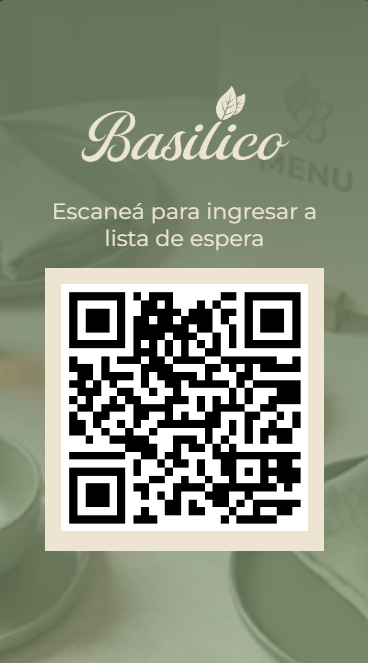

### 🍽️ QRs de Mesas
Qr para escanear mesa 1

  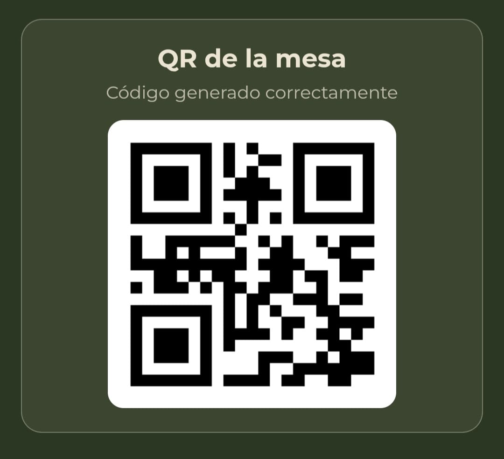

Qr para escanear mesa 2

  

Qr para escanear mesa 3

  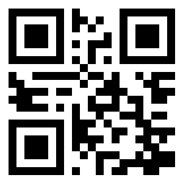

Qr para escanear mesa 4

  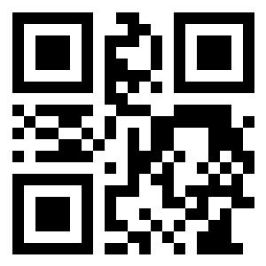

Qr para escanear mesa 5

  

Qr para escanear mesa 6

  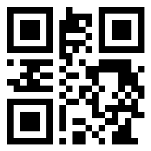

Qr para escanear mesa 7

  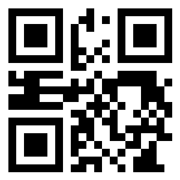

### 💰 QRs de Propinas

Al pedir la cuenta (Punto 21), el cliente **debe** escanear uno de estos cinco códigos para indicar su satisfacción. El porcentaje lo define el servidor a partir del código: no se aceptan otros valores ni QR de mesa, ingreso o DNI.
También se pueden mostrar en pantalla desde la app: **Mozo → Cuentas y liberación → Mostrar los QR de propina** (ruta `/qr-propinas`).

| Satisfacción | Propina | Contenido del QR |
| :--- | :---: | :--- |
| Excelente | 20% | `BASILICO:PROPINA:EXCELENTE:20` |
| Muy Bueno | 15% | `BASILICO:PROPINA:MUY_BUENO:15` |
| Bueno | 10% | `BASILICO:PROPINA:BUENO:10` |
| Regular | 5% | `BASILICO:PROPINA:REGULAR:5` |
| Malo | 0% | `BASILICO:PROPINA:MALO:0` |

Excelente (20%)

  

Muy Bueno (15%)

  

Bueno (10%)

  

Regular (5%)

  

Malo (0%)

  

---

# 🖼️ Índice de Imágenes del Proyecto

*Índice de las imágenes, pantallas, formularios y elementos visuales implementados en la aplicación.*

## 🌐 Pantallas Generales

### 1. Pantalla de Inicio

Pantalla principal de la aplicación. Desde aquí el usuario puede iniciar sesión, registrarse o ingresar como cliente anónimo.

  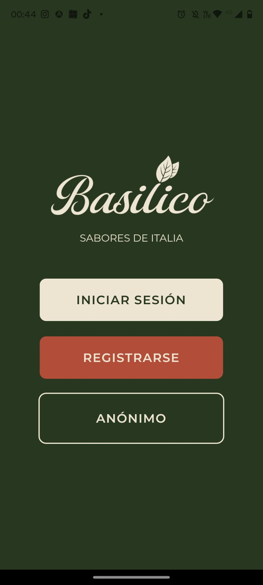

---

### 2. Inicio de Sesión

Pantalla para el ingreso de usuarios registrados mediante correo electrónico y contraseña.

  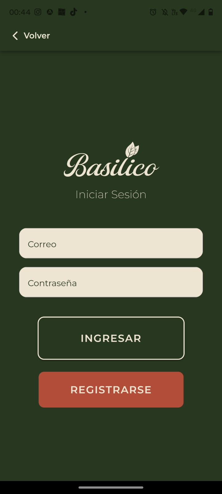

---

### 3. Registro de Cliente

Formulario para el registro de un nuevo cliente. Permite ingresar nombre, apellido, DNI, correo electrónico, contraseña y fotografía tomada desde el dispositivo.

  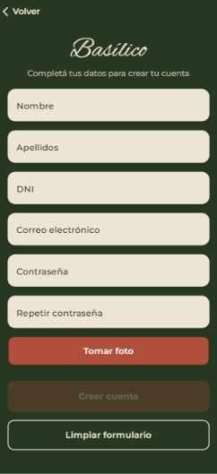

---

### 4. Registro de Cliente Anónimo

Pantalla de ingreso sin registro previo. El cliente anónimo ingresa su nombre y toma una fotografía desde el dispositivo.

  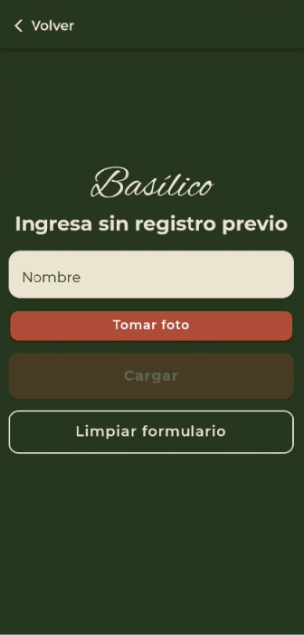

---

### 5. Ícono de la Aplicación

Ícono identificatorio de la aplicación Basílico.

  

Icono splash con nombre de los integrantes

  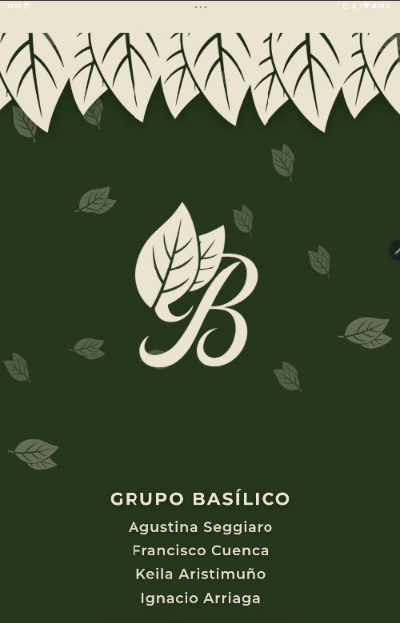

---

### 6. Ingreso Rápido por Perfil

Pantalla de ingreso rápido utilizada para acceder a la aplicación con los distintos perfiles disponibles.

  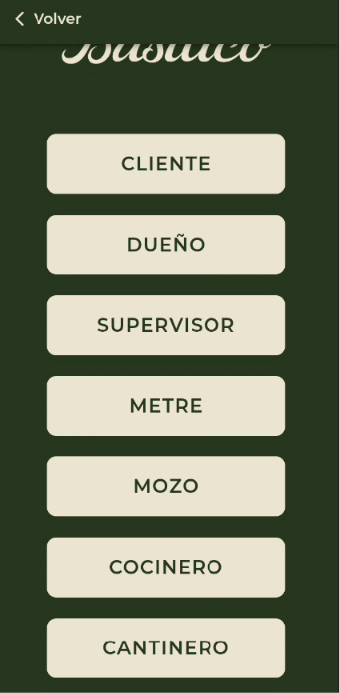

Los perfiles disponibles son:

- Cliente
- Dueño
- Supervisor
- Metre
- Mozo
- Cocinero
- Cantinero

---

## 👤 Dueño / Supervisor

### 1. Pantalla Principal del Dueño

Pantalla principal correspondiente al perfil dueño. Desde esta sección se centralizan las funcionalidades administrativas disponibles para la gestión del restaurante.

Actualmente permite acceder a:

- **Alta de empleados:** registro de nuevos empleados del restaurante.
- **Alta de mesa:** registro y gestión de nuevas mesas.
- **Clientes pendientes:** visualización y gestión de clientes registrados que se encuentran pendientes de aprobación.

  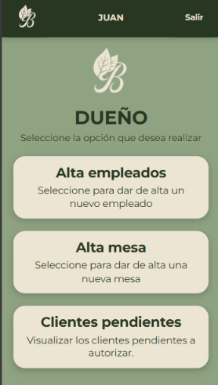

---

### 2. Alta de Empleados

Permite al dueño o supervisor registrar un nuevo empleado, ingresando sus datos personales y laborales, junto con una fotografía tomada desde el dispositivo.

La funcionalidad contempla la validación de los datos ingresados y la posibilidad de utilizar la lectura del código QR del DNI para completar la información correspondiente.

  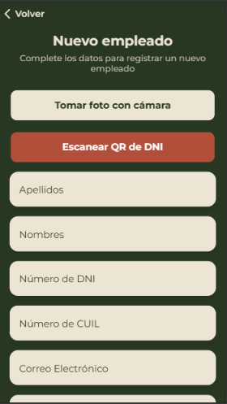

  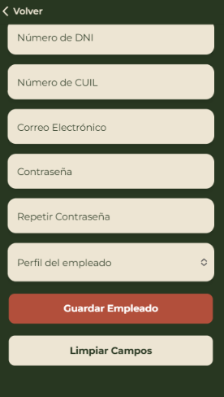

---

### 3. Alta de Mesa

Permite al dueño o supervisor registrar una nueva mesa indicando sus datos correspondientes, como número, cantidad de comensales, tipo y fotografía.

Al registrar la mesa, se genera el código QR correspondiente y posteriormente puede gestionarse su disponibilidad.

  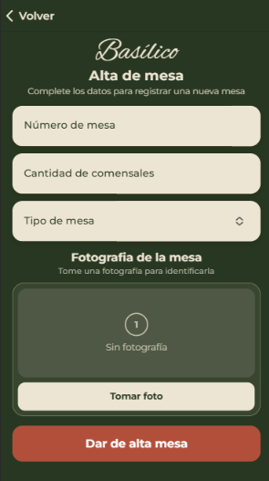
  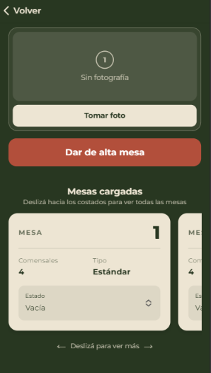

---

### 4. Clientes Pendientes

Permite al dueño o supervisor visualizar los clientes registrados que se encuentran pendientes de aprobación.

Desde esta sección se puede consultar la información del cliente y gestionar su solicitud, permitiendo aceptar o rechazar su registro.

  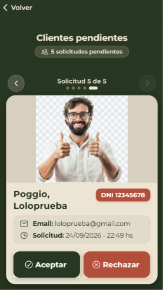

---

## 🍳 Cocinero / Cantinero

### 1. Pantalla Principal de Cocina

Pantalla principal correspondiente al perfil cocinero. Desde esta sección se centralizan las funcionalidades relacionadas con la gestión de platos y los pedidos correspondientes al sector cocina.

Actualmente permite acceder a:

- **Agregar plato:** incorporación de nuevos platos a la carta.
- **Ver carta:** consulta de los productos disponibles.
- **Pedidos pendientes:** visualización de los pedidos que deben ser preparados por el sector cocina.

  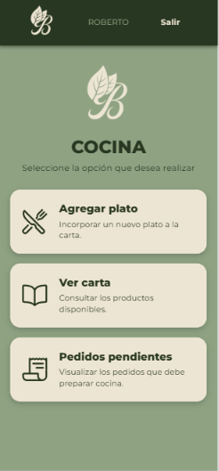

---

### 2. Alta de Plato

Permite al cocinero incorporar un nuevo plato a la carta del restaurante.

El formulario permite ingresar:

- Nombre del plato.
- Descripción.
- Tiempo estimado de elaboración en minutos.
- Precio.
- Tres fotografías diferentes del producto.

La pantalla dispone de tres contenedores individuales para cargar y visualizar las fotografías del plato antes de realizar el alta.

  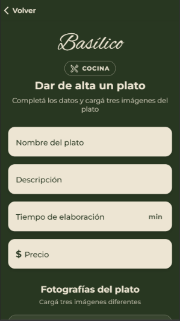
  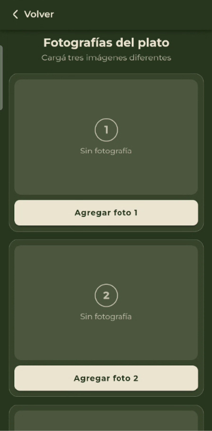

Una vez completados los datos y cargadas las tres fotografías, el cocinero puede registrar el nuevo plato mediante la opción **"Dar de alta el plato"** o acceder directamente a la carta mediante **"Ver carta"**.

---

### 3. Carta de Productos

Pantalla destinada a la visualización de los productos disponibles en la carta del restaurante.

Cada producto presenta su información correspondiente, incluyendo nombre, descripción, precio y tiempo estimado de elaboración. Las fotografías pueden recorrerse mediante el carrusel de imágenes disponible en cada producto.

  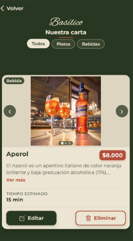

**Editar menu**

  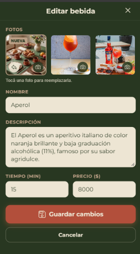

**Eliminar menu**

  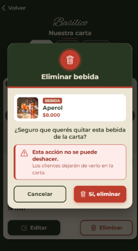

---

### 4. Pedidos Pendientes de Cocina

Esta sección permitirá al cocinero visualizar los pedidos confirmados que contienen productos correspondientes al sector cocina.

Los pedidos deberán mostrar la mesa correspondiente, fecha y hora, junto con los productos y cantidades que deben ser preparados, agrupados por número de mesa.

  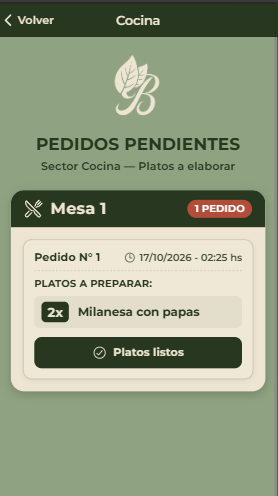

**Sin pedidos pendientes**

  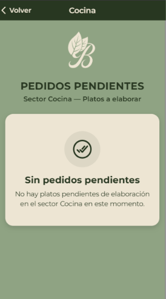

---
### 5. Pantalla Principal del Cantinero

Pantalla principal correspondiente al perfil cantinero, desde la cual se accederá a las funcionalidades relacionadas con bebidas y pedidos destinados al sector bar.

  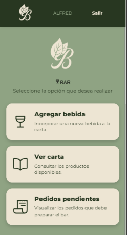

---

### 6. Alta de Bebida — Cantinero

Permite al cantinero incorporar una nueva bebida a la carta del restaurante.

Al igual que en el alta de platos, se ingresan el nombre, descripción, tiempo estimado de elaboración, precio y tres fotografías del producto.

  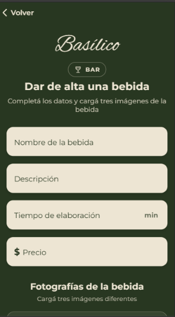

---
### 7. Pedidos Pendientes Cantinero

Esta sección permite al cantinero visualizar los pedidos confirmados que contienen productos correspondientes al sector BAR.

Los pedidos muestran la mesa correspondiente, número de pedido, fecha y hora, junto con las bebidas y cantidades que deben ser preparadas, agrupados por número de mesa. Al presionar **Bebidas listos**, el producto se marca como terminado.

  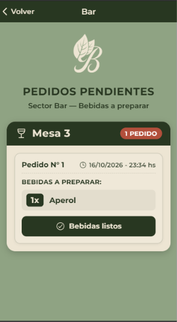

---

### 8. Sin Pedidos Pendientes y Aviso al Mozo

Cuando todos los productos de un pedido están listos, el sistema avisa automáticamente al mozo (push notification) que el pedido de la mesa está completo para su entrega. Si no quedan productos por preparar, el sector muestra el estado **"Sin pedidos pendientes"**.

  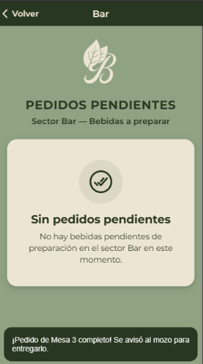

---

## 👤 Cliente

### 1. Pantalla Principal del Cliente antes de recepcionarse

Pantalla principal correspondiente al perfil cliente. Desde esta sección el usuario puede escanear el código QR de ingreso al local para anotarse en la lista de espera.

La versión actual incorpora la barra de navegación con el logo, el título de la sección y la opción **Salir**, y confirma el registro del token para recibir push notifications.

  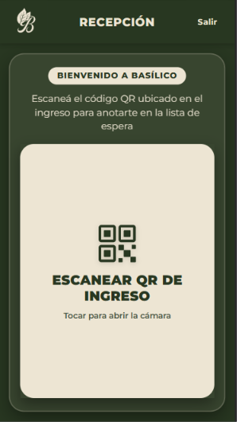

---

### 2. Cargar cantidad de comensales

Esta pantalla se visualiza una vez que el usuario escaneo el QR para recepcionarse. En la misma debe elegir la cantidad de comensales para que llegue la información completa al METRE

  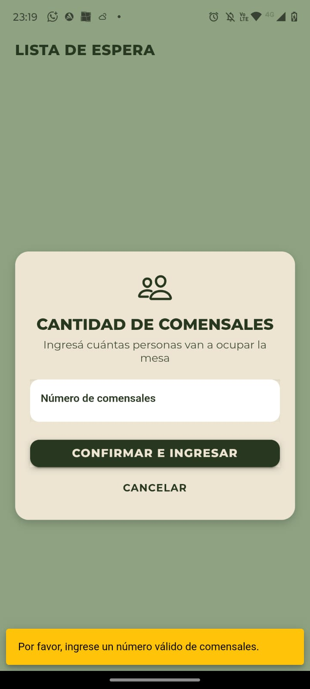

---
### 3. Pendiente confirmacion por metre

El cliente espera confirmacion del metre

  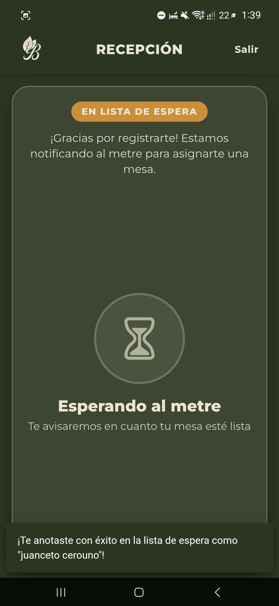

---

### 4. Mesa Asignada — Escaneo del QR de Mesa

Una vez que el metre asigna la mesa, el cliente visualiza el número de mesa asignado y debe dirigirse a ella y escanear su código QR para confirmar su ubicación en el restaurante.

Desde esta pantalla también puede **ver los resultados de las encuestas** de clientes anteriores.

  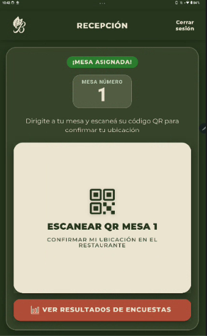

---

### 5. Listo para Ordenar

Luego de validar el QR de la mesa, el cliente visualiza su mesa y nombre de comensal, y puede elegir entre:

- **Hacer pedido:** acceder a la carta para armar el pedido.
- **Consulta al mozo:** enviar una consulta al mozo.

  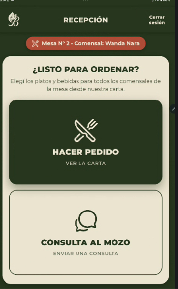

---

### 6. Carta y Armado del Pedido

El cliente recorre la carta filtrando por **Todos**, **Platos** o **Bebidas**. Cada producto muestra su carrusel de fotos, descripción, precio y tiempo estimado, y permite agregarlo al pedido o modificar su cantidad.

El **importe acumulado** y el **tiempo estimado** se mantienen siempre visibles en la parte inferior, junto al botón **Ver pedido**.

  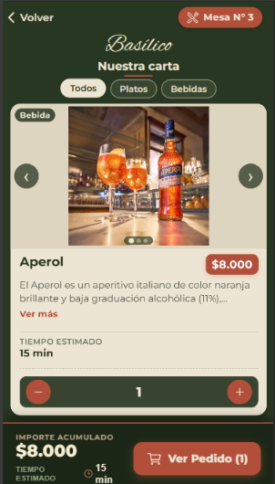
  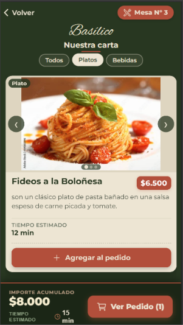

---

### 7. Confirmar Pedido

Resumen del pedido antes de enviarlo al mozo: productos con su sector, cantidad y precio, tiempo estimado total e importe total. El cliente puede **terminar y enviar el pedido** o **seguir agregando productos**.

Al finalizar, el mozo recibe una notificación automática para autorizar el pedido.

  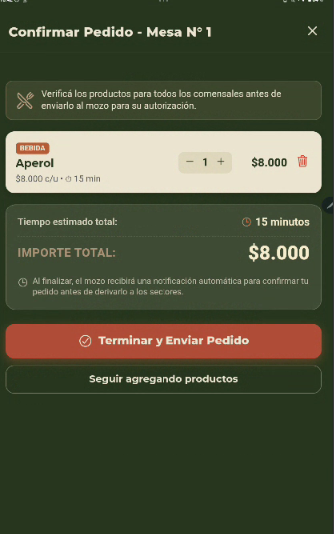

---

### 8. Estado del Pedido — Esperando Confirmación del Mozo

Tras enviar el pedido, el cliente visualiza su estado (**"Esperando confirmación del mozo"**), el importe acumulado, el tiempo total estimado y el detalle de los ítems. Desde aquí también puede realizar una consulta al mozo.

  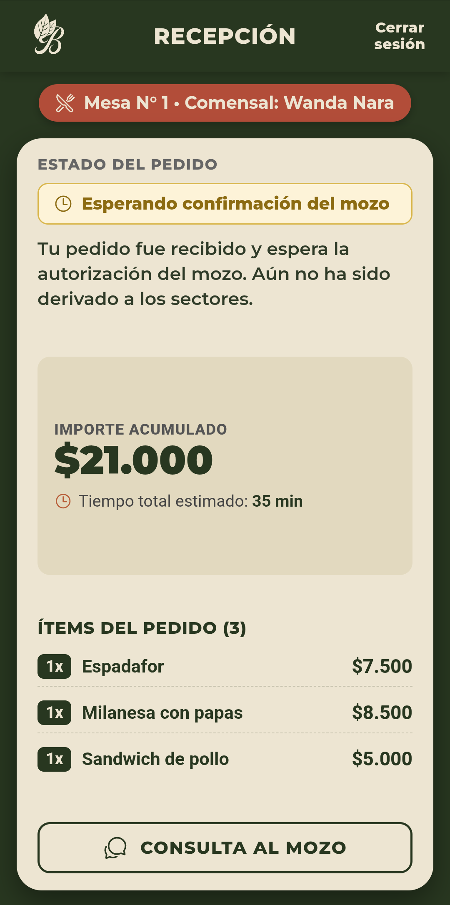

**Consulta al mozo (Chat)**

Al tocar **Consulta al mozo**, el cliente ingresa al **Chat Global de Basílico**, donde puede intercambiar mensajes con los mozos. Cada mensaje indica quién lo envió (mesa o mozo) y la fecha y hora.

  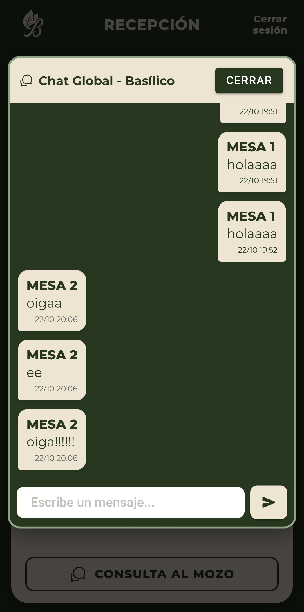

---

### 9. Estado del Pedido — Confirmado y en Preparación

Una vez que el mozo confirma el pedido, este se deriva a cocina y/o bar y el cliente ve el estado de preparación de cada sector. En este momento se habilita el acceso a **Juegos y Descuentos**.

  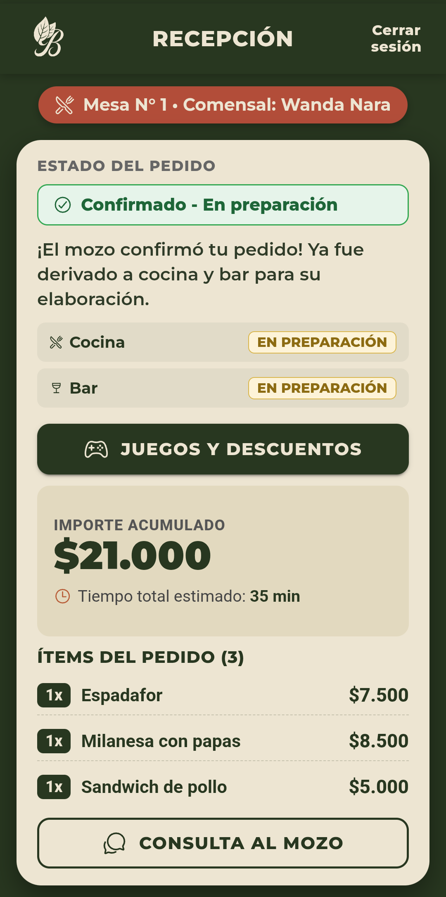

**Pedido rechazado por mozo**

  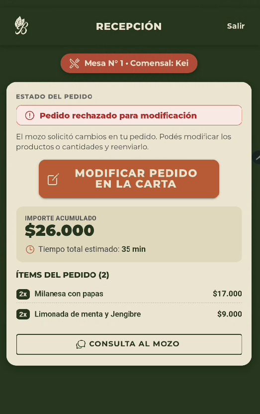

---
### 10. Estado del Pedido — Confirmado y listo

Una vez que el mozo confirma el pedido, este se deriva a cocina y/o bar y el cliente ve el estado de preparación de cada sector. En este momento se habilita el acceso a **Juegos y Descuentos**.

  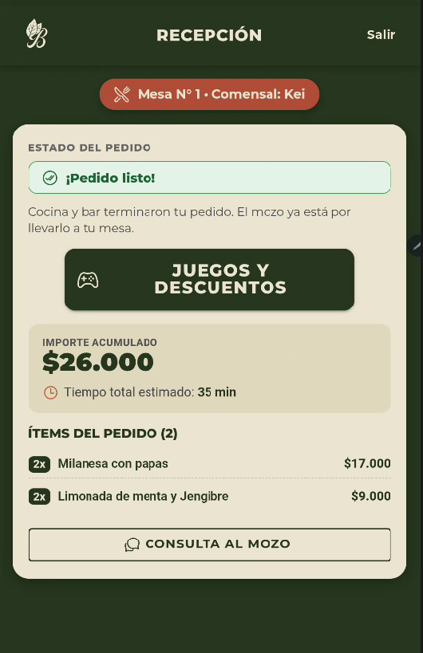

---

### 11. Juegos y Descuentos

Sección destinada a los juegos disponibles para clientes registrados. Los juegos permiten obtener descuentos sobre la cuenta final según las condiciones establecidas para cada uno.

El beneficio se obtiene únicamente al ganar en el primer intento y el primer descuento conseguido será el aplicado a la cuenta.

Pantalla de inicio de la sección de juegos, rediseñada a pantalla completa con botones XXL y navbar con título. Muestra la **regla de promoción** (ganá en tu primer intento y obtené hasta 20% OFF) y el listado de juegos disponibles:

| Juego | Descripción | Descuento |
| :--- | :--- | :---: |
| Bingo Basílico | Llenar el cartón con las bolillas sorteadas | 10% |
| Mayor o Menor | Adivinar si la siguiente carta de cocina es mayor o menor | 15% |
| Trivia Culinaria | Preguntas sobre sabores y tradiciones de la cocina italiana | 20% |

Para facilitar las pruebas, la barra inferior permite simular cada descuento (+10%, +15%, +20%) y reiniciar el estado.

  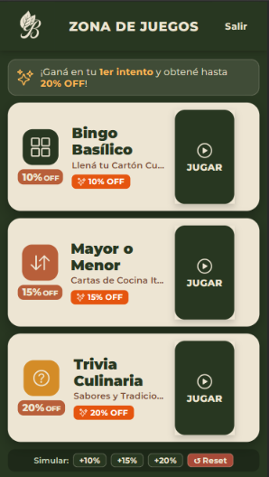

**Usuario anonimo no obtiene descuentos**

  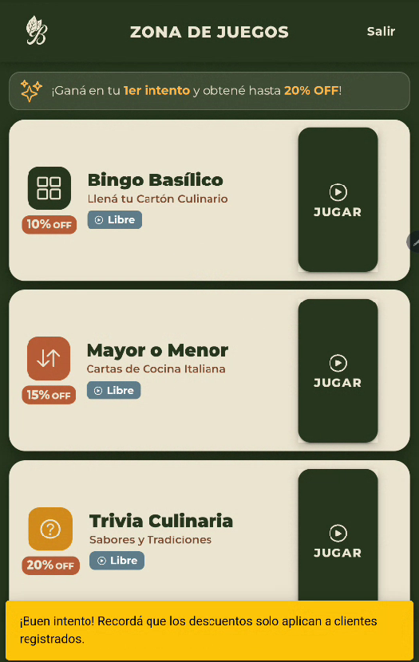

**juego terminado**

  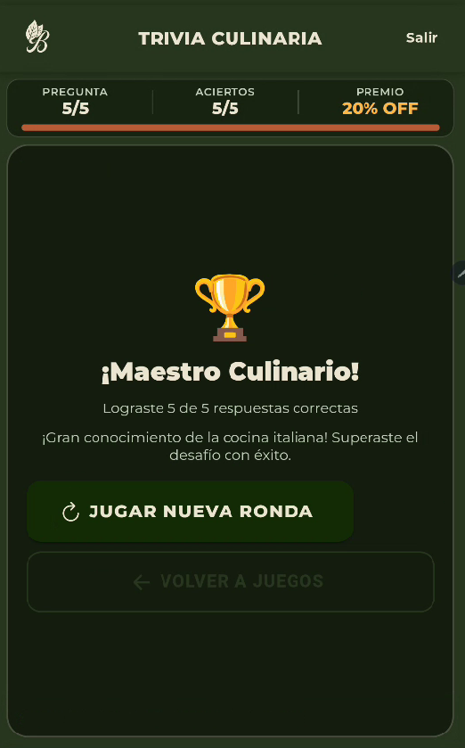

---

### 1. Bingo Basílico (10% OFF)

El cliente saca bolillas y marca los números de su cartón. Se muestran el premio, las chances restantes, los aciertos y las bolillas que ya salieron.

  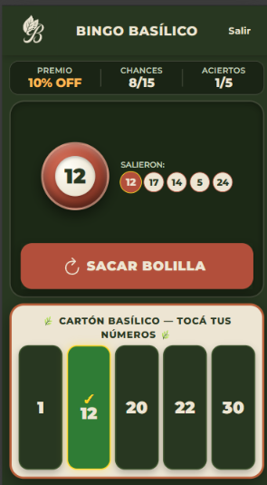

---

### 2. Mayor o Menor (15% OFF)

El cliente debe adivinar si la siguiente carta (platos de la carta con un valor del 1 al 12) será **mayor** o **menor** que la actual. Se muestran el premio, los aciertos y las vidas restantes.

  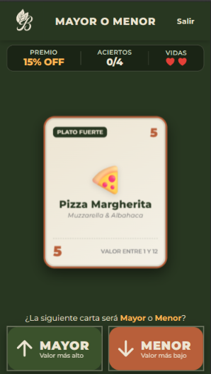

---

### 3. Trivia Culinaria (20% OFF)

Trivia de 5 preguntas sobre cocina italiana organizadas por categoría (salsas, tradición, etc.). Al responder, se marca la opción correcta en verde y la incorrecta en rojo, junto con un dato curioso sobre la respuesta.

  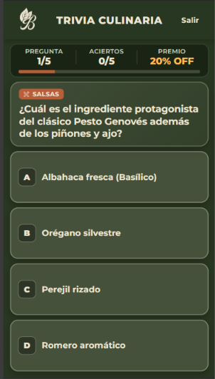
  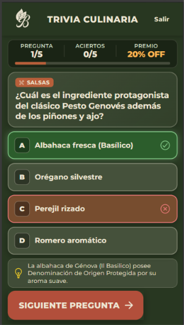
  

---

## 🧑‍🍳 Mozo / Metre

### 1. Pantalla Principal del Metre

Pantalla principal correspondiente al perfil metre. Desde esta sección se centralizan las funcionalidades relacionadas con el ingreso de clientes al restaurante y la asignación de mesas.

Actualmente permite acceder a:

- **Registro de cliente:** permite registrar un nuevo cliente en el sistema.
- **Lista de espera:** permite visualizar los clientes que se encuentran esperando una mesa y gestionar la asignación correspondiente.

  

---

### 2. Lista de espera

Desde la lista de espera, el metre puede visualizar los clientes que solicitaron ingresar al restaurante y se encuentran esperando la asignación de una mesa.

Una vez disponible una mesa, el metre puede asignarla al cliente correspondiente para continuar con el flujo de atención.

  

**Sin clientes pendientes**

  

---

### 3. Asignación de mesa

Al seleccionar un cliente de la lista de espera, el metre visualiza las mesas disponibles con su cantidad de comensales y tipo (estándar / VIP), y asigna la mesa mediante el botón **Asignar**. También puede rechazar la solicitud del cliente.

Al asignarse la mesa, el cliente recibe una push notification para escanear el QR de su mesa.

  

---

### 4. Pantalla Principal del Mozo

Pantalla principal correspondiente al perfil mozo. Desde esta sección se centralizan las funcionalidades necesarias para gestionar los pedidos, la entrega de productos, las cuentas de las mesas y las consultas realizadas por los clientes.

Actualmente dispone de los siguientes accesos:

- **Pedidos:** pedidos enviados por los clientes que requieren autorización o rechazo por parte del mozo.
- **Pedidos listos:** pedidos cuya preparación fue finalizada y se encuentran disponibles para ser entregados.
- **Cuentas y liberación:** gestión del proceso de cobro y posterior liberación de la mesa.
- **Chat de consultas:** acceso a las consultas y conversaciones iniciadas por los clientes.

Cada acceso muestra un contador con la cantidad de elementos pendientes (por ejemplo, pedidos a autorizar o chats nuevos).

  

---

### 5. Nuevos Pedidos

Pantalla de **Autorización de Pedidos**, destinada a visualizar los nuevos pedidos realizados por los clientes.

Cada pedido muestra la mesa, el comensal, la fecha y hora, los productos solicitados con su sector (cocina / bar) y precio, el tiempo estimado y el importe total. El mozo puede:

- **Rechazar (pedir modificación):** el cliente podrá modificar los productos o cantidades y volver a enviar el pedido.
- **Confirmar y derivar:** el pedido se deriva a los sectores correspondientes para comenzar su preparación.

  

  

---

### 6. Pedidos Listos

Sección destinada a visualizar los pedidos cuya preparación fue completada por los sectores correspondientes.

El pedido deberá estar disponible para entrega una vez que todos los productos que lo componen se encuentren listos. Desde esta sección, el mozo podrá identificar los pedidos preparados y continuar con la entrega al cliente.

  

**pedidos listos y en preparacion**

  

---

### 7. Cuentas y Liberación de Mesa

Sección destinada a gestionar las cuentas solicitadas por los clientes y completar el proceso de pago.

Luego de la confirmación correspondiente, se podrá finalizar la atención y liberar la mesa para que vuelva a estar disponible.

> 📷 **Captura pendiente:** Se incorporará la captura correspondiente cuando la interfaz se encuentre disponible.

<!-- Captura pendiente: 04-cuentas-liberacion-mozo.png -->

---

### 8. Chat de Consultas

Sección destinada a recibir y responder las consultas realizadas por los clientes desde sus mesas.

El sistema permitirá mantener una sala de conversación entre clientes y mozos, identificando las consultas correspondientes y permitiendo continuar la comunicación durante la atención.

  

---

## 📊 Encuestas y Gráficos

### 1. Acceso a la Encuesta desde la Pantalla del Cliente

Una vez recibido el pedido, el cliente accede a un menú desde el cual puede jugar por descuentos, **completar la encuesta de satisfacción**, consultar los **resultados de la encuesta** o pedir la cuenta.

  

---

### 2. Encuesta — Paso 1 de 2

El cliente califica del 1 al 10 su experiencia en Basílico. En este paso se evalúan:

- **Calidad de la comida:** mediante un control deslizante (slider).
- **Atención del mozo:** seleccionando un número con botones de opción (radio buttons).

  

---

### 3. Encuesta — Paso 2 de 2

Segundo paso de la encuesta, donde se evalúan:

- **Ambiente y limpieza:** con botones de más/menos o tocando las estrellas.
- **Experiencia general:** eligiendo entre **Malo**, **Regular**, **Bueno**, **Muy Bueno** o **Excelente**.

Desde aquí el cliente puede volver al paso anterior, **enviar la encuesta** o **ver los resultados históricos**.

  

---

### 4. Encuesta Completada

Una vez enviada la encuesta, el botón cambia a **Encuesta completada** y queda deshabilitado, ya que cada cliente puede responder la encuesta una sola vez por estadía. Los resultados siguen disponibles para consultar.

  

---

### 5. Estadísticas — Promedio por Categoría (Gráfico de Barras)

Primera pantalla de estadísticas. Muestra el puntaje promedio (del 1 al 10) otorgado por los comensales a cada categoría: **Comida**, **Atención** y **Ambiente**. En la parte superior se indica la cantidad total de encuestas y el promedio general.

  

---

### 6. Estadísticas — Experiencia General (Gráfico de Torta)

Segunda pantalla de estadísticas. Muestra la distribución de las respuestas según las 5 opciones de calificación (**Excelente**, **Muy Bueno**, **Bueno**, **Regular** y **Malo**), con el porcentaje y la cantidad de votos de cada una, y el promedio general en el centro del gráfico.

  

---

### 7. Estadísticas — Evolución de Calificaciones (Gráfico Lineal)

Tercera pantalla de estadísticas. Muestra la tendencia de satisfacción en las últimas 8 encuestas, junto con la calificación **mínima**, el **promedio** y la **máxima** obtenidas.

  

---

## 📧 Correos Electrónicos Automáticos

Al aceptar o rechazar un cliente registrado desde **Clientes Pendientes** (Puntos 7 y 8), el sistema envía automáticamente un correo personalizado mediante la Edge Function de Supabase `enviar-correo` (servicio Resend), con el logo de Basílico, los colores y tipografías propios de la marca.

### 1. Mail de Solicitud recibida por cliente

El cliente recibe un correo notificando que su solicitud fue recibida y se encuentra en observacion.

  

### 2. Mail de Aceptación de Cliente Registrado

Correo incluye la etiqueta **"Registro Aprobado"**, el título **"¡Cuenta Habilitada!"**, el DNI registrado y el estado *Habilitado*, e invita al cliente a ingresar a la aplicación con su correo y contraseña.

  

---

### 3. Mail de Rechazo de Cliente Registrado

Correo incluye la etiqueta **"Solicitud No Admitida"**, el título **"Solicitud Desestimada"**, el DNI consultado y el estado *No admitido*, junto con la indicación de comunicarse con la administración ante cualquier error.

  

---

