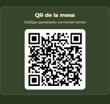
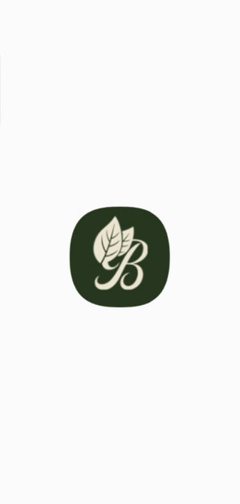
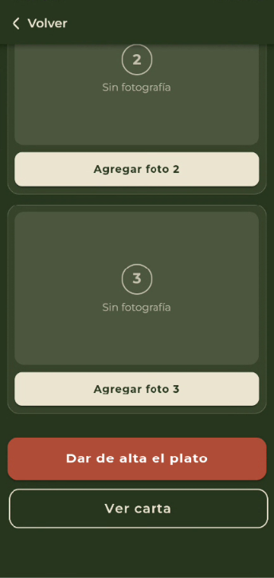
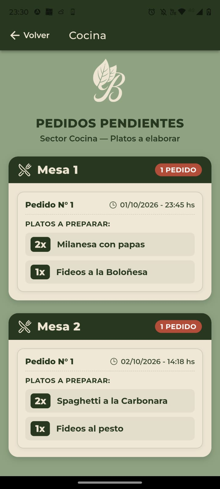
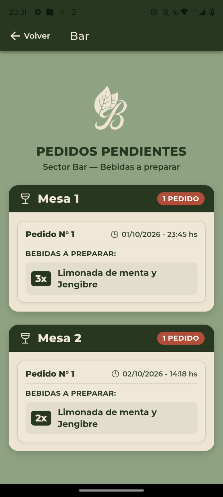
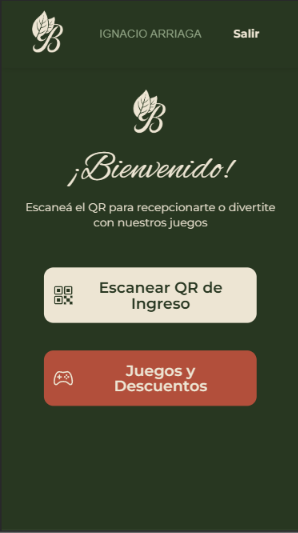
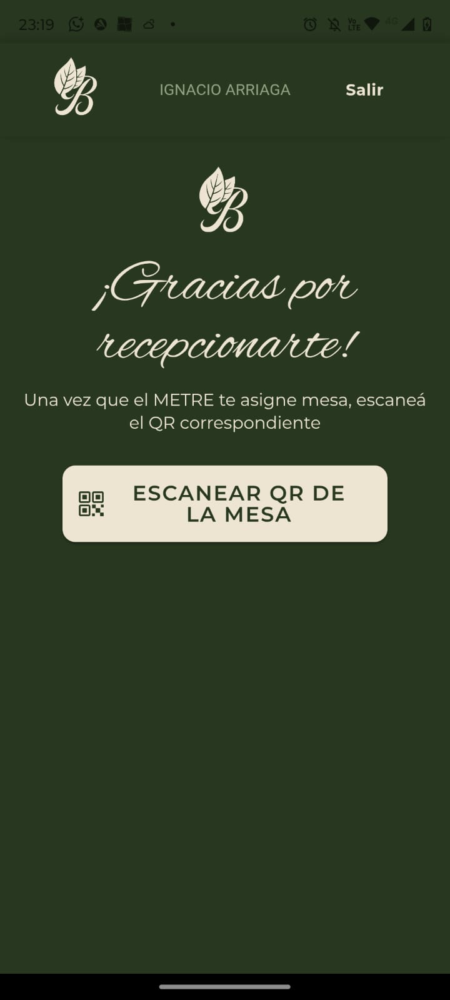
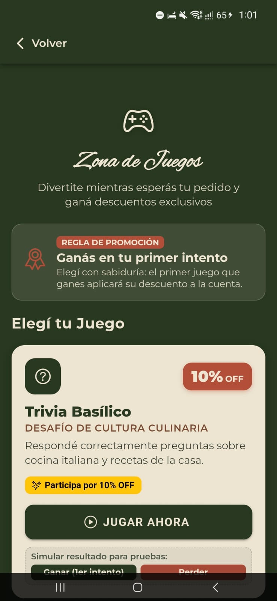
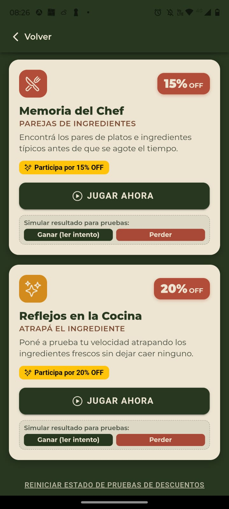

# Basilico - Proyecto de Gestión de Restaurante 🍽️
### **Grupo:** Basilico - 2026

### **Tecnicatura Universitaria en Programación - UTN Avellaneda**

 `Link del proyecto Supabase:` https://xmlcpvfjlnuakqehrvom.supabase.co --> integrado al repo
### **Grupo:** Basilico - 2026

---

## 👥 Integrantes y Responsabilidades

De acuerdo con las pautas del Trabajo Final Integrador, a continuación se detallan los módulos asignados, las fechas estimadas de desarrollo y las ramas de trabajo de cada integrante:

### Francisco Cuenca Backoffice (Dueño / Supervisor)
Puntos del enunciado: 1, 4, 6, 7, 8, 22, 25
Punto 1 — Alta de empleado (foto desde cámara, lectura QR de DNI, validaciones)
Punto 4 — Alta y gestión de mesas (tipo, disponibilidad, foto) + generación automática de QR de mesa
Punto 6 — Listado de clientes pendientes de aprobación (con push notification)
Punto 7 y 8 — Aceptar/rechazar cliente + envío de correo automático personalizado (logo, fuentes,
colores propios)
Punto 22 — Generación de factura en PDF + notificación automática a dueño/supervisor tras el pago
Punto 25 — Aprobación/rechazo de reservas (segunda/tercera fecha)

### Keila Aristimuño— Cocina y Bar (Productos)
Puntos del enunciado: 2, 3, 16, 17, 18
Punto 2 — Alta de plato (nombre, descripción, tiempo, precio, 3 fotos con carrusel)
Punto 3 — Alta de bebida (misma lógica que plato)
Punto 16 — Pantalla de pedidos pendientes en cocina, agrupados por mesa
Punto 17 — Pantalla de pedidos pendientes en bar, agrupados por mesa
Punto 18 — Marcar productos listos y avisar al mozo cuando el pedido está completo (push notification)

### Ignacio Arriaga — Experiencia del Cliente
Puntos del enunciado: 5, 9, 11, 12, 13, 14, 15, 20, 21
Punto 5 — Registro de cliente registrado (foto, DNI con QR, estado "pendiente de aprobación")
Punto 9 — Ingreso como cliente anónimo + anotarse en lista de espera
Punto 11 — Ver menú de productos (carrusel de imágenes, precio, descripción, tiempo)
Punto 12, 13, 14 — Armar pedido (con importe acumulado siempre visible), modificarlo si el mozo lo
rechaza, ver estado
Punto 15 — Sección de juegos (3 juegos simples con descuentos 10/15/20%)
Punto 20 — Encuesta de satisfacción + visualización de resultados en gráficos
Punto 21 — Pedir la cuenta, elegir propina vía QR, ver detalle y total

### Seggiaro Agustina — Mozo / Metre + Infraestructura transversal
Puntos del enunciado: 10, 11 (consulta al mozo), 19, + tareas transversales
Punto 10 — Lista de espera del metre + asignación de mesa a cliente
Punto 11 (parte mozo) — Recepción de "consulta al mozo" + sala de conversación estilo chat
Punto 12/13/14 (parte mozo) — Confirmar o rechazar pedido, derivarlo a sectores
Punto 19 — Entrega del pedido completo + cambio de estado
Liderar el servicio central de Supabase y el sistema de notificaciones push (por ser quien más interactúacon todos los flujos)

---
### 👤 Aristimuño, Keila - Líder del Grupo

* **Planificación de Tareas:**

| Tarea / Módulo | Fecha Inicio | Fecha Fin (Estimada/Real) | Branch | Estado |
| :--- | :---: | :---: | :---: | :---: |
| Configuración inicial del repositorio | 28/08/2026 | 28/08/2026 | `main` / `develop` | Finalizado |
| Estilos generales | 05/09/2026 | 05/09/2026 | `feature/estilos-globales` | Finalizado|
|Punto 2 — Alta de plato | 10/09 | 17/09 |feature/alta-plato |Finalizado |
|Diseño registro | 17/09 | 17/09 |feature/alta-plato |Finalizado |
|Service Vibracion | 17/09 | 17/09 |feature/alta-plato |Finalizado |
|Carta/menu | 17/09 | 18/09 |feature/Carta|Finalizado |
|Inicio Cocinero | 18/09 | 19/09 |feature/cocinero-inicio|Finalizado |
|Navbar y logout | 19/09 | 19/09 |feature/cocinero-inicio|Finalizado |
|Alta bebida | 24/09 | 24/09 |feature/alta-bebida|Finalizado |
|capturas doc | 25/09 | 25/09 |doc/capturas|Finalizado |
|Alta mesa diseño | 25/09 | 25/09 |develop|Finalizado |
|Inicio cantinero | 25/09 | 25/09 |develop|Finalizado |

---

### 👤 Cuenca, Francisco

* **Planificación de Tareas:**

| Tarea / Módulo | Fecha Inicio | Fecha Fin (Estimada/Real) | Branch | Estado |
| :--- | :---: | :---: | :---: | :---: |
| Sevicio reutilizable de QR | 04/09/2026 | 04/09/2026 | `feature/qr-service` | Finalizado |
| Punto 1 — Alta de empleado | 05/09/2026 | 13/09/2025 | `feature/alta-empleado` | Finalizado |
| Punto 4 — Alta de mesas | 13/09/2026 | 19/09/2025 | `feature/alta-mesas` | Finalizado |
| Punto 6 — Listado clientes pendientes de aprobación | 16/09/2026 | 19/09/2025 | `feature/listado-clientes` | Finalizado |
| Servicio push notifications y tokens con Firebase | 17/09/2026 | 19/09/2025 | `feature/notifications-service` | Finalizado |
| Agrego logo a push notifications | 19/09/2026 | 19/09/2025 | `feature/notifications-service` | Finalizado |
| Punto 7 — Rechazar cliente + envío de correo automático | 18/09/2026 | 20/09/2025 | `feature/mail-respuesta-solicitud-cliente` | Finalizado |
| Punto 8 — Aceptar cliente + envío de correo automático | 18/09/2026 | 20/09/2025 | `feature/mail-respuesta-solicitud-cliente` | Finalizado |
| Verificación de estado de cliente en login (pendiente, rechazado, aprobado) | 19/09/2026 | 20/09/2025 | `feature/mail-respuesta-solicitud-cliente` | Finalizado |

---
### 👤 Ignacio Arriaga
* **Módulos / Objetivos a desarrollar:** 
* **Planificación de Tareas:**

| Tarea / Módulo | Fecha Inicio | Fecha Fin (Estimada/Real) | Branch | Estado |
| :--- | :---: | :---: | :---: | :---: |
| Desarrollo del Juego de Descuento (10%, 15%, 20%) | 21/09/2026 | DD/MM/2026 | `feature/juegos` | En proceso |
| [Módulo W] | DD/MM/2026 | DD/MM/2026 | `feature/modulo-w` | Pendiente |

---
### 👤 Seggiaro, Agustina Anabel
* **Módulos / Objetivos a desarrollar:** 
 - Login principal
 - Metre
 - Mozo
 - Nexo entre cliente / metre / mozo
* **Planificación de Tareas:**

| Tarea / Módulo | Fecha Inicio | Fecha Fin (Estimada/Real) | Branch | Estado |
| :--- | :---: | :---: | :---: | :---: |
| Login principal (Validaciones) | 08/09/2026 | 10/09/2026 | `feature/registro-login` | Finalizado |
| Pantalla de incio (Redirigir) | 08/09/2026 | 10/09/2026 | `feature/registro-login` | Finalizado |
| Acceso rápido (Redirigir) | 10/09/2026 | - | `feature/registro-login` | Finalizado |
| Pantalla inicio Metre | 10/09/2026 | 15/09/2026 | `feature/mozo-metre` | Finalizado |
| Pantalla inicio Mozo | 10/09/2026 | 17/09/2023 | `feature/mozo-metre` | Finalizado |
| Pantalla inicio cliente | 15/09/2026 |  17/09/2023 | `feature/develop` | Finalizado |
| Código QR ingreso local | 15/09/2026 |  17/09/2023 | `feature/develop` | Finalizado |
| Entrada de cliente a lista de espera | 15/09/2026 |  17/09/2023 | `feature/develop` | Finalizado |
| Lista de espera mozo | 21/09/2026 | - | `feature/develop` | En proceso |
| Registro  cliente anonimo | 23/09/2026 | 24/09/2026 |  `feature/develop`| Finalizado |

---

## 📲 Códigos QR del Proyecto

*Requisito excluyente: Todos los códigos QR deben estar disponibles para las pruebas.*

> Los códigos QR se incorporarán en esta sección a medida que sean generados y validados.

### 🚪 QR de Ingreso al Local

Qr al ingresar un cliente al local para figurar en listad e espera

  

### 🍽️ QRs de Mesas
Qr para escanear mesa

  

### 💰 QRs de Propinas

<!-- Pendientes de agregar -->

- Excelente (20%)
- Muy Bueno (15%)
- Bueno (10%)
- Regular (5%)
- Malo (0%)

---

# 🖼️ Índice de Imágenes del Proyecto

*Índice de las imágenes, pantallas, formularios y elementos visuales implementados en la aplicación.*

## 🌐 Pantallas Generales

### 1. Pantalla de Inicio

Pantalla principal de la aplicación. Desde aquí el usuario puede iniciar sesión, registrarse o ingresar como cliente anónimo.

  

---

### 2. Inicio de Sesión

Pantalla para el ingreso de usuarios registrados mediante correo electrónico y contraseña.

  

---

### 3. Registro de Cliente

Formulario para el registro de un nuevo cliente. Permite ingresar nombre, apellido, DNI, correo electrónico, contraseña y fotografía tomada desde el dispositivo.

  

---

### 4. Registro de Cliente Anónimo

Pantalla de ingreso sin registro previo. El cliente anónimo ingresa su nombre y toma una fotografía desde el dispositivo.

  

---

### 5. Ícono de la Aplicación

Ícono identificatorio de la aplicación Basílico.

  

---

### 6. Ingreso Rápido por Perfil

Pantalla de ingreso rápido utilizada para acceder a la aplicación con los distintos perfiles disponibles.

  

Los perfiles disponibles son:

- Cliente
- Dueño
- Supervisor
- Metre
- Mozo
- Cocinero
- Cantinero

---

## 👤 Dueño / Supervisor

### 1. Pantalla Principal del Dueño

Pantalla principal correspondiente al perfil dueño. Desde esta sección se centralizan las funcionalidades administrativas disponibles para la gestión del restaurante.

Actualmente permite acceder a:

- **Alta de empleados:** registro de nuevos empleados del restaurante.
- **Alta de mesa:** registro y gestión de nuevas mesas.
- **Clientes pendientes:** visualización y gestión de clientes registrados que se encuentran pendientes de aprobación.

  

---

### 2. Alta de Empleados

Permite al dueño o supervisor registrar un nuevo empleado, ingresando sus datos personales y laborales, junto con una fotografía tomada desde el dispositivo.

La funcionalidad contempla la validación de los datos ingresados y la posibilidad de utilizar la lectura del código QR del DNI para completar la información correspondiente.

  

---

### 3. Alta de Mesa

Permite al dueño o supervisor registrar una nueva mesa indicando sus datos correspondientes, como número, cantidad de comensales, tipo y fotografía.

Al registrar la mesa, se genera el código QR correspondiente y posteriormente puede gestionarse su disponibilidad.

  
  

---

### 4. Clientes Pendientes

Permite al dueño o supervisor visualizar los clientes registrados que se encuentran pendientes de aprobación.

Desde esta sección se puede consultar la información del cliente y gestionar su solicitud, permitiendo aceptar o rechazar su registro.

  

---

## 🍳 Cocinero / Cantinero

### 1. Pantalla Principal de Cocina

Pantalla principal correspondiente al perfil cocinero. Desde esta sección se centralizan las funcionalidades relacionadas con la gestión de platos y los pedidos correspondientes al sector cocina.

Actualmente permite acceder a:

- **Agregar plato:** incorporación de nuevos platos a la carta.
- **Ver carta:** consulta de los productos disponibles.
- **Pedidos pendientes:** visualización de los pedidos que deben ser preparados por el sector cocina.

  

---

### 2. Alta de Plato

Permite al cocinero incorporar un nuevo plato a la carta del restaurante.

El formulario permite ingresar:

- Nombre del plato.
- Descripción.
- Tiempo estimado de elaboración en minutos.
- Precio.
- Tres fotografías diferentes del producto.

La pantalla dispone de tres contenedores individuales para cargar y visualizar las fotografías del plato antes de realizar el alta.

  
  

  

Una vez completados los datos y cargadas las tres fotografías, el cocinero puede registrar el nuevo plato mediante la opción **"Dar de alta el plato"** o acceder directamente a la carta mediante **"Ver carta"**.

---

### 3. Carta de Productos

Pantalla destinada a la visualización de los productos disponibles en la carta del restaurante.

Cada producto presenta su información correspondiente, incluyendo nombre, descripción, precio y tiempo estimado de elaboración. Las fotografías pueden recorrerse mediante el carrusel de imágenes disponible en cada producto.

  

---

### 4. Pedidos Pendientes de Cocina

Esta sección permitirá al cocinero visualizar los pedidos confirmados que contienen productos correspondientes al sector cocina.

Los pedidos deberán mostrar la mesa correspondiente, fecha y hora, junto con los productos y cantidades que deben ser preparados, agrupados por número de mesa.

  

---
### 5. Pantalla Principal del Cantinero

Pantalla principal correspondiente al perfil cantinero, desde la cual se accederá a las funcionalidades relacionadas con bebidas y pedidos destinados al sector bar.

  

---

### 6. Alta de Bebida — Cantinero

Permite al cantinero incorporar una nueva bebida a la carta del restaurante.

Al igual que en el alta de platos, se ingresan el nombre, descripción, tiempo estimado de elaboración, precio y tres fotografías del producto.

  

---
### 7. Pedidos Pendientes Cantinero

Esta sección permitirá al cantinero visualizar los pedidos confirmados que contienen productos correspondientes al sector BAR.

Los pedidos deberán mostrar la mesa correspondiente, fecha y hora, junto con los productos y cantidades que deben ser preparados, agrupados por número de mesa.

  

## 👤 Cliente

### 1. Pantalla Principal del Cliente antes de repcionarse

Pantalla principal correspondiente al perfil cliente. Desde esta sección el usuario puede escanear el código QR de ingreso al local para acceder al flujo de atención del restaurante.

  

### 2. Cargar cantidad de comensales

Esta pantalla se visualiza una vez que el usuario escaneo el QR para recepcionarse. En la misma debe elegir la cantidad de comensales para que llegue la información completa al METRE

  

---

### 3. Pantalla "Gracias por recepcionarte"
Esta pantalla se visualiza una vez que el cliente eligio la cantidad de comensales y le llego al metre correctamente la solicitud. 
Pantalla de espera hasta que el metre asigne mesa.
Boton para una vez que se le asigne mesa (Push notification) pueda escanear el QR de la mesa

  

---

### 2. Juegos y Descuentos

Sección destinada a los juegos disponibles para clientes registrados. Los juegos permiten obtener descuentos sobre la cuenta final según las condiciones establecidas para cada uno.

El beneficio se obtiene únicamente al ganar en el primer intento y el primer descuento conseguido será el aplicado a la cuenta.

> 🚧 **En desarrollo:** La sección de juegos se encuentra actualmente en proceso de implementación. La captura corresponde al estado actual de la interfaz y será actualizada a medida que avance el desarrollo.

Pagina de inicio de juegos 

  

  

---

## 🧑‍🍳 Mozo / Metre

### 1. Pantalla Principal del Metre

Pantalla principal correspondiente al perfil metre. Desde esta sección se centralizan las funcionalidades relacionadas con el ingreso de clientes al restaurante y la asignación de mesas.

Actualmente permite acceder a:

- **Registro de cliente:** permite registrar un nuevo cliente en el sistema.
- **Lista de espera:** permite visualizar los clientes que se encuentran esperando una mesa y gestionar la asignación correspondiente.

  

---

### 2. Lista de espera

Desde la lista de espera, el metre puede visualizar los clientes que solicitaron ingresar al restaurante y se encuentran esperando la asignación de una mesa.

Una vez disponible una mesa, el metre puede asignarla al cliente correspondiente para continuar con el flujo de atención.

  

---

### 3. Asiganción de mesa

Desde la lista de espera, el metre puede visualizar los clientes que solicitaron ingresar al restaurante y se encuentran esperando la asignación de una mesa.

Una vez disponible una mesa, el metre puede asignarla al cliente correspondiente para continuar con el flujo de atención.

  

---

### 3. Pantalla Principal del Mozo

Pantalla principal correspondiente al perfil mozo. Desde esta sección se centralizan las funcionalidades necesarias para gestionar los pedidos, la entrega de productos, las cuentas de las mesas y las consultas realizadas por los clientes.

Actualmente dispone de los siguientes accesos:

- **Nuevos pedidos:** pedidos enviados por los clientes que requieren confirmación o rechazo por parte del mozo.
- **Pedidos listos:** pedidos cuya preparación fue finalizada y se encuentran disponibles para ser entregados.
- **Cuentas y liberación:** gestión del proceso de cobro y posterior liberación de la mesa.
- **Chat de consultas:** acceso a las consultas y conversaciones iniciadas por los clientes.

  

---

### 4. Nuevos Pedidos

Sección destinada a visualizar los nuevos pedidos realizados por los clientes.

El mozo podrá revisar el pedido recibido y decidir si lo **confirma** o lo **rechaza**. En caso de ser rechazado, el cliente podrá modificar los productos o cantidades y volver a enviar el pedido.

Una vez confirmado por el mozo, el pedido será derivado a los sectores correspondientes para comenzar su preparación.

> 🚧 **En desarrollo:** La implementación de la gestión de nuevos pedidos se encuentra actualmente en proceso. La captura de esta pantalla será incorporada cuando la funcionalidad se encuentre finalizada.

<!-- Captura pendiente: 02-nuevos-pedidos-mozo.png -->

---

### 5. Pedidos Listos

Sección destinada a visualizar los pedidos cuya preparación fue completada por los sectores correspondientes.

El pedido deberá estar disponible para entrega una vez que todos los productos que lo componen se encuentren listos. Desde esta sección, el mozo podrá identificar los pedidos preparados y continuar con la entrega al cliente.

> 🚧 **En desarrollo:** La implementación de la gestión de pedidos listos se encuentra actualmente en proceso. La captura de esta pantalla será incorporada cuando la funcionalidad se encuentre finalizada.

<!-- Captura pendiente: 03-pedidos-listos-mozo.png -->

---

### 6. Cuentas y Liberación de Mesa

Sección destinada a gestionar las cuentas solicitadas por los clientes y completar el proceso de pago.

Luego de la confirmación correspondiente, se podrá finalizar la atención y liberar la mesa para que vuelva a estar disponible.

> 📷 **Captura pendiente:** Se incorporará la captura correspondiente cuando la interfaz se encuentre disponible.

<!-- Captura pendiente: 04-cuentas-liberacion-mozo.png -->

---

### 7. Chat de Consultas

Sección destinada a recibir y responder las consultas realizadas por los clientes desde sus mesas.

El sistema permitirá mantener una sala de conversación entre clientes y mozos, identificando las consultas correspondientes y permitiendo continuar la comunicación durante la atención.

> 📷 **Captura pendiente:** Se incorporará la captura correspondiente cuando la interfaz se encuentre disponible.

<!-- Captura pendiente: 05-chat-consultas-mozo.png -->

---

## 🎮 Juegos

*Las capturas correspondientes a los juegos de descuento se incorporarán a medida que sean desarrollados.*

---

## 📊 Encuestas y Gráficos

*Las capturas correspondientes a las encuestas y gráficos estadísticos se incorporarán a medida que sean desarrollados.*

---

